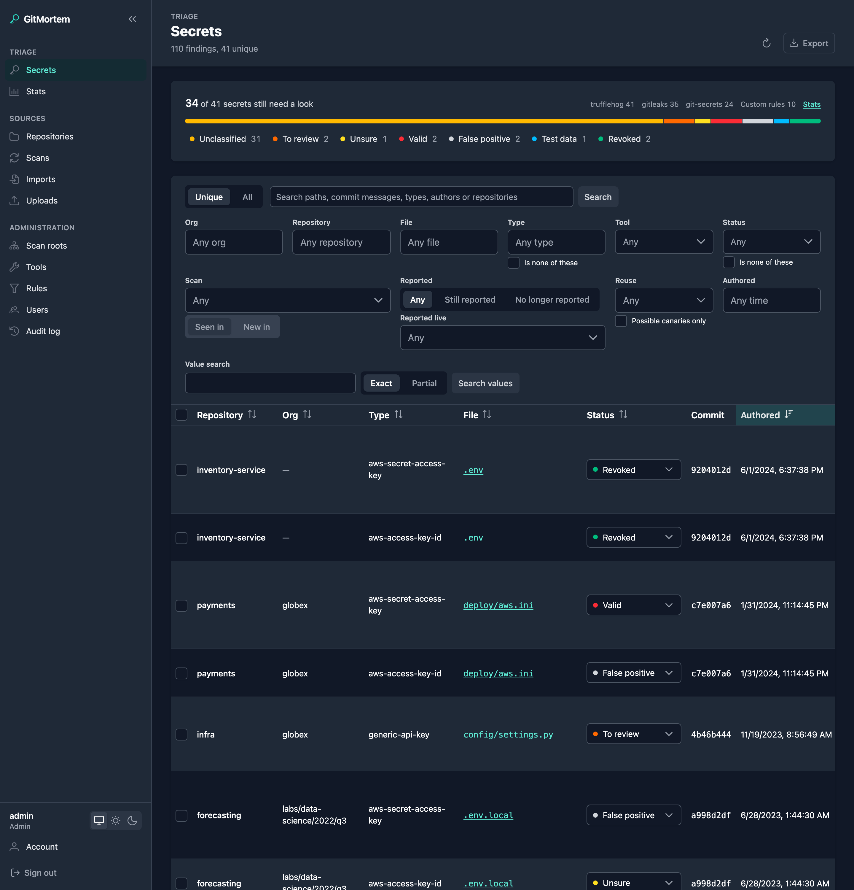
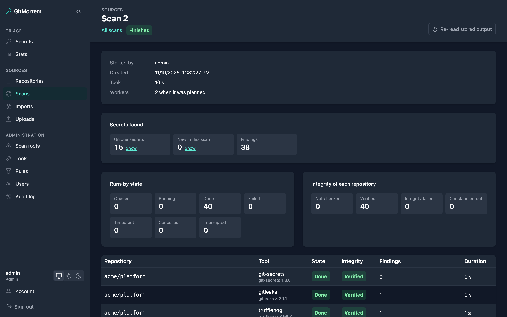
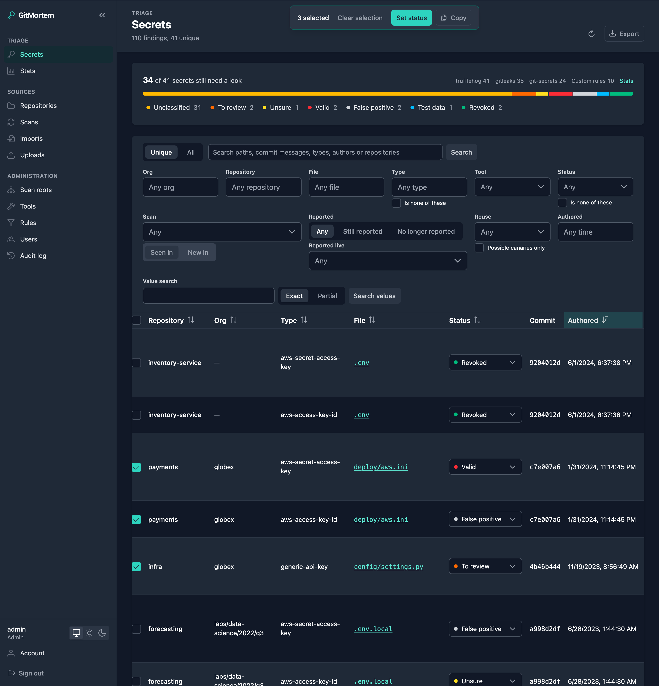
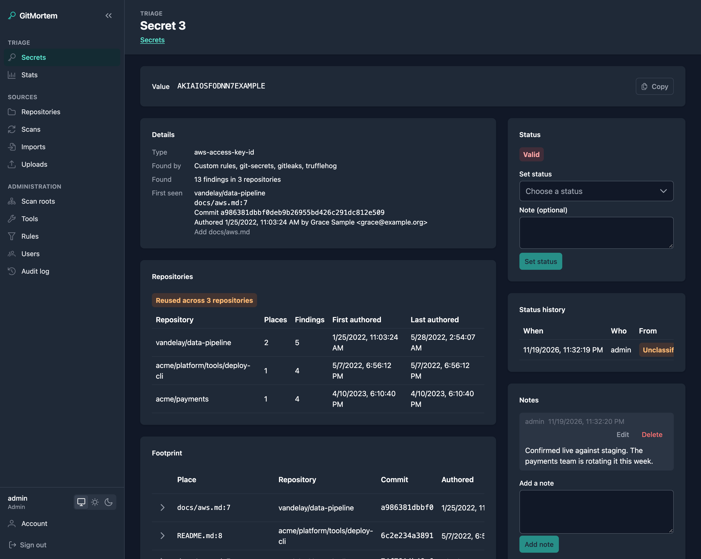
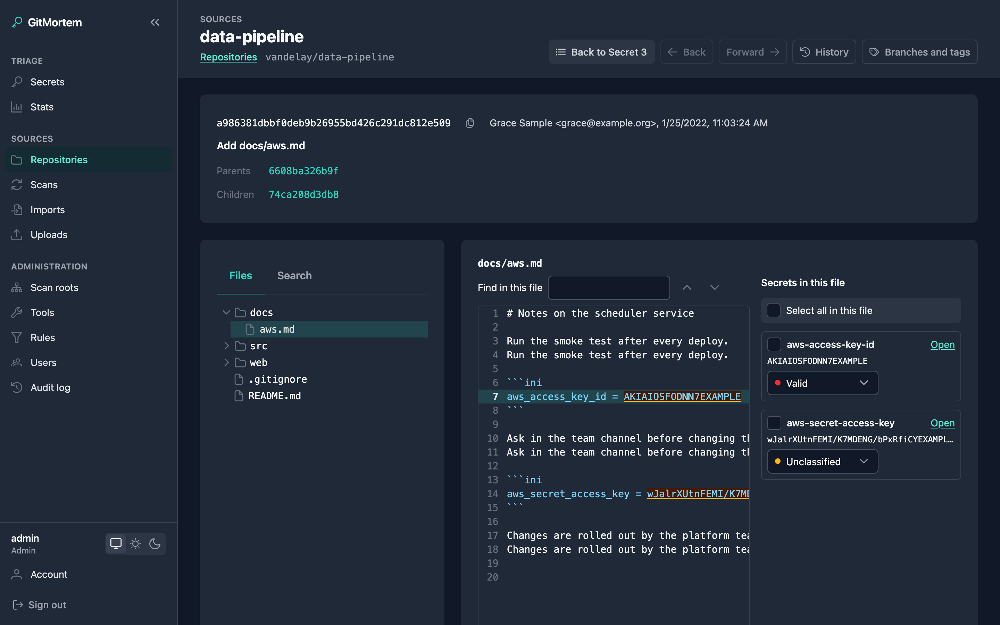

# GitMortem

GitMortem is a triage tool for secrets leaked into git. It runs gitleaks, TruffleHog, git-secrets and rules of your own over the whole history of every repository you point it at, and puts what they find in one list: each secret once, with every place it turned up. Your team works through that list together, marking each secret valid, revoked, a false positive and so on, adding notes, and reading the code it came from at the commit where it was found.

You can find my related blog post at [https://thehackingblog.com/2026/11/23/secrets-in-git-a-red-teamers-guide/](https://thehackingblog.com/2026/11/23/secrets-in-git-a-red-teamers-guide/)



It runs on your own machine or as a server for the team, and never goes online while it runs.

## Install

GitMortem installs from a clone of this repository: the installer builds it from the folder. That takes Node.js 20.19+ or 22.12+. If the machine has neither, the installer downloads one and checks it; on Debian and Ubuntu that one needs the `libatomic1` package. The scanners are not bundled either. The installer downloads them and asks which versions you want: the ones GitMortem was tested with, or each tool's newest release that is at least a week old.

### On your machine (macOS or Linux)

You need git 2.34 or newer, and curl.

```bash
git clone https://github.com/Jack-Barradell/GitMortem.git
cd GitMortem
./install.sh
./run.sh
```

`run.sh` starts GitMortem with `gitmortem local`, and is how you start it again after you stop it; anything you put after it goes to `gitmortem local`, as in `./run.sh --port 9000`. The installer also links `gitmortem` into `~/.local/bin`, so with that folder on your `PATH` you can type `gitmortem local` from anywhere.

`gitmortem local` asks you to choose a username and password for the first admin, then opens http://127.0.0.1:8765/ in your browser. It only listens on 127.0.0.1, so nobody else on your network can reach it.

### On your machine, in Docker

You need Docker. From the clone:

```bash
./docker-local.sh --repos ~/code
```

The script builds the image, asks for the first admin, installs the scanners into a Docker volume called `gitmortem-local` and opens http://127.0.0.1:8766/. Each `--repos` folder is mounted read-only and appears as `/repos/<folder name>` when you add a scan root. The volume keeps everything between runs.

The same with Docker Compose:

```bash
docker compose build
docker compose run --rm create-admin --username <name>
GITMORTEM_REPOS=~/code docker compose up
```

### On a server (Ubuntu 22.04 or 24.04)

Point a domain name at the server, or use its IP address, and open ports 80 and 443. Then:

```bash
git clone https://github.com/Jack-Barradell/GitMortem.git
cd GitMortem
sudo ./install.sh --server
```

The setup asks for the server's address, the scanner versions and the first admin, and runs GitMortem as a service behind [Caddy](https://caddyserver.com), which serves it over HTTPS. A domain name or a public IP address gets a certificate from Let's Encrypt. A private address gets one from Caddy's own authority, and the setup tells you how to trust it. GitMortem itself listens only on a Unix socket that only Caddy can reach, and has no network access of its own.

<details>
<summary>Using your own certificate</summary>

Pass the setup your certificate (with its chain) and its key, both as PEM files:

```bash
sudo ./install.sh --server -- --cert /path/to/cert.pem --key /path/to/key.pem
```

The setup copies them to `/etc/caddy/tls/`, with the key readable only by root and Caddy, and keeps them when you run it again. To renew, run it again with the new files.

</details>

<details>
<summary>Putting repositories on the server</summary>

GitMortem scans repositories in `/srv/gitmortem/repos`. Clone or copy them in as the `gitmortem` user:

```bash
sudo -u gitmortem git clone <url> /srv/gitmortem/repos/<name>
```

The `gitmortem` account can write to that folder. If you clone a repository there as yourself, anything running as that account could add a hook that your own git would later run. Clone as `gitmortem` and your git refuses to work in the repository, so such a hook never runs.

</details>

### On a server, in Docker

Build the image from the clone:

```bash
docker build -f docker/gitmortem.Dockerfile -t gitmortem .
```

Make a key, keep it in a file only root can read, and start the container behind your own HTTPS proxy:

```bash
sudo install -m 600 /dev/null /etc/gitmortem.env
echo "GITMORTEM_INSTANCE_KEY=$(openssl rand -base64 32 | tr '+/' '-_')" | sudo tee /etc/gitmortem.env > /dev/null
sudo docker run -it -v gitmortem-data:/data -p 127.0.0.1:8080:8080 --env-file /etc/gitmortem.env gitmortem \
  --allowed-host gitmortem.example.org --trusted-proxy <your proxy's address, as the container sees it>
```

<details>
<summary>About the key, the port and the scanners</summary>

Never put the key on the command line, where any account on the machine can read it in the process list, and never pass it with `-e`. Docker reads an `--env-file` itself before the container starts, which is why `docker run` needs `sudo` here. Don't make the file readable by other accounts to get round that.

The port is published on 127.0.0.1 only, so clients reach GitMortem through your proxy and never around it.

The image has no scanners in it. On its first start it installs them into the volume. To choose which, set `GITMORTEM_SCANNERS` in the env file to `known-good` (the default), `latest` or `none`.

</details>

### Windows (not yet tested)

You need [Git for Windows](https://git-scm.com/download/win), which brings git and the bash that git-secrets runs in. From the clone:

```powershell
powershell -ExecutionPolicy Bypass -File .\install.ps1
powershell -ExecutionPolicy Bypass -File .\run.ps1
```

`run.ps1` starts GitMortem with `gitmortem local`, and is how you start it again after you stop it. The installer puts `gitmortem.cmd` in `%LOCALAPPDATA%\GitMortem\app\bin`; add that folder to your `PATH` to type `gitmortem local` from anywhere.

## Using GitMortem

### Add a folder of repositories

Sign in as the admin you created, open the Scan roots page and add a folder that holds your repositories. Then, on the Repositories page, press **Discover repositories** and GitMortem lists every git repository inside that folder. On your own machine you can add any folder inside your home folder. For repositories kept somewhere else, such as another drive, start GitMortem with `--scan-root-base <folder>`, as in `./run.sh --scan-root-base /mnt/repos` (on Windows, add `--scan-root-base D:\repos` to the `run.ps1` line). You can give it more than once, and the folders you name take the place of your home folder, so name that too if you still want it. Pass it each time you start GitMortem. A server only takes folders inside the ones it was started with (`--scan-root-base`); for a server set up by `install.sh` that is `/srv/gitmortem/repos`.

### Scan

Select repositories on the Repositories page and press **Scan selected**. When a root holds repositories that have never been scanned, only those are ticked, so after adding more you scan just the new ones; **Select all** ticks the rest for a full rescan. The table sorts on every column and filters by org, kind, state and when each was last scanned. Each installed scanner runs over each repository's whole history, reflogs and linked worktrees included. The scan's page counts the unique secrets found so far, and those new in that scan, as each run finishes, and has a row for every run, with the scanner's version and what it found. Admins can see which scanners were found, and change their options, on the Tools page.



### Work through the secrets

Filter the Secrets page by organisation, repository, type, tool, status or scan, or narrow it to secrets that turn up in more than one repository. For an organisation, repository or type, type a few letters and pick from the matches, which show how many secrets each holds; **Is none of these** turns a type or status choice into the ones left out. You can search paths, commit messages and authors, or look up a value you already have. To classify, pick a status from a row's menu, or tick several rows and press **Set status**. The statuses are Valid, Invalid, False positive, Test data (for a fake value made for testing), Revoked, Canary (for a token planted to catch whoever uses it), Unsure and To review, and **Undo** puts a change back. If a colleague changed one of those secrets after you loaded the page, GitMortem skips it and tells you which.



To classify one file's secrets across its whole history, pick the repository and then the file in **File**, press **Select all N matching**, and set their status in one go.

To check your own canaries turn up in scans, tick **Possible canaries only**. A secret is marked *Possible canary* when a word such as canary, honeytoken or decoy appears in its commit message, file path, line or author, and its page asks whether to set it to Canary. Admins can add the words your team uses on the Tools page.

### Open a secret

A secret's page shows its value and its footprint: every repository, commit, file and line where it was found, and which scanners found it there. Its status history and the team's notes are alongside.



### Read the code

The **Explore** button next to each finding opens the repository at that commit, with the finding's line marked. From there you can open other files, walk the history, switch between branches and tags, and search file names and contents. It all comes from git's objects; nothing is checked out or written. Beside the file, a panel lists the secrets that appear in it, and you can set their statuses there, one at a time or ticked together, possible canaries marked as on the Secrets page; clicking a highlighted value picks its entry. **Back to Secrets** returns to the list as you left it, filters, page and search included.



### Add your own rules

Admins can add regular expressions for your own token formats on the Rules page, and test a pattern against sample text before saving it. Rules apply from the next scan.

### Uploads and imports

Repositories that aren't on the machine can come in as zip files on the Uploads page, several gigabytes if need be. Each repository in a zip is scanned as soon as it is unpacked. If you upload one again, you choose whether it replaces the copy GitMortem has or is kept beside it as a new version.

Reports from gitleaks, TruffleHog or git-secrets runs done somewhere else go in on the Imports page. You see what an import holds before you confirm it, and can remove it later.

After an upgrade, **Re-read stored output** on a scan's page parses that scan's saved reports again with the current parsers. It adds new findings and marks those no longer reported, but never deletes any.

### Stats and exports

The Stats page totals the secrets by organisation, repository, type, status and tool. **Export** on the Secrets page saves the filtered list as txt, json, csv or xlsx, with or without the values, and the audit log records who exported what.

### Users and roles

Admins add colleagues on the Users page, as admins or analysts. Analysts can scan, upload, import, triage, explore and export. Admins can also manage scan roots, scanners and their options, rules and users, delete repositories, and read the audit log.

## Commands

| Command | What it does |
|---|---|
| `gitmortem local` | Runs GitMortem for one person, on 127.0.0.1 only. `--port` moves it off 8765, and `--no-browser` stops it opening the browser. |
| `gitmortem serve --allowed-host <name>` | Runs it as a team server. Behind a proxy, add `--trusted-proxy <its address>`. |
| `gitmortem create-admin --username <name>` | Creates the first admin, or another one. |
| `gitmortem reset-password --username <name>` | Sets a new password, for example for an admin who is locked out. |
| `gitmortem install-scanners --choice known-good` | Downloads and checks the scanners (`known-good` or `latest`). This command goes online. |
| `gitmortem clear-audit --older-than <days>` | Deletes old audit events (`--all` for every one), leaving one event that records the clear. |
| `gitmortem demo-corpus <empty folder>` | Writes fake repositories with fake secrets all through their history, to try GitMortem on. |

`local` and `serve` also take `--scan-root-base <folder>` and `--tool-path <tool>=<path>`, both repeatable, and `--data-dir` and `--key-file`. Every command has `--help`.

## Your data

| System | Data folder | Key file |
|---|---|---|
| macOS | `~/Library/Application Support/GitMortem` | `~/Library/Application Support/GitMortem/instance.key` |
| Linux | `~/.local/share/GitMortem` | `~/.config/GitMortem/instance.key` |
| Windows | `%LOCALAPPDATA%\GitMortem` | `%LOCALAPPDATA%\GitMortem\instance.key` |

On Linux, `$XDG_DATA_HOME` and `$XDG_CONFIG_HOME` move these if you set them. A server set up by `install.sh` keeps both in `/var/lib/gitmortem`. A server you start by hand has no default key file: pass `--key-file`, or set `GITMORTEM_INSTANCE_KEY`.

Secret values, matched lines, commit messages, notes and stored scanner output are encrypted with the key file, so the database is no use without it. Keep the two together.

GitMortem keeps no backup of its own. To back up, stop it and copy the data folder and the key file. Do that before every upgrade as well, because a database migration can't be undone.

To upgrade, pull the latest `main` and run the installer again:

```bash
git pull
./install.sh        # on a server: sudo ./install.sh --server
```

To change or upgrade only the scanners, run `gitmortem install-scanners --choice known-good` (or `latest`).

## Licence

MIT. See [LICENSE](LICENSE).
